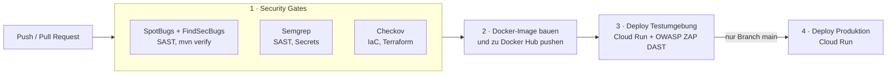
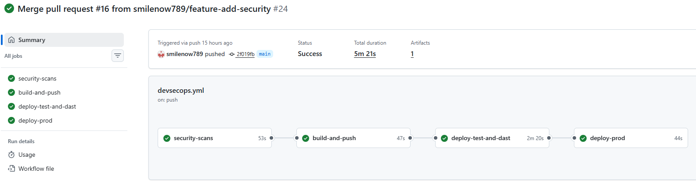
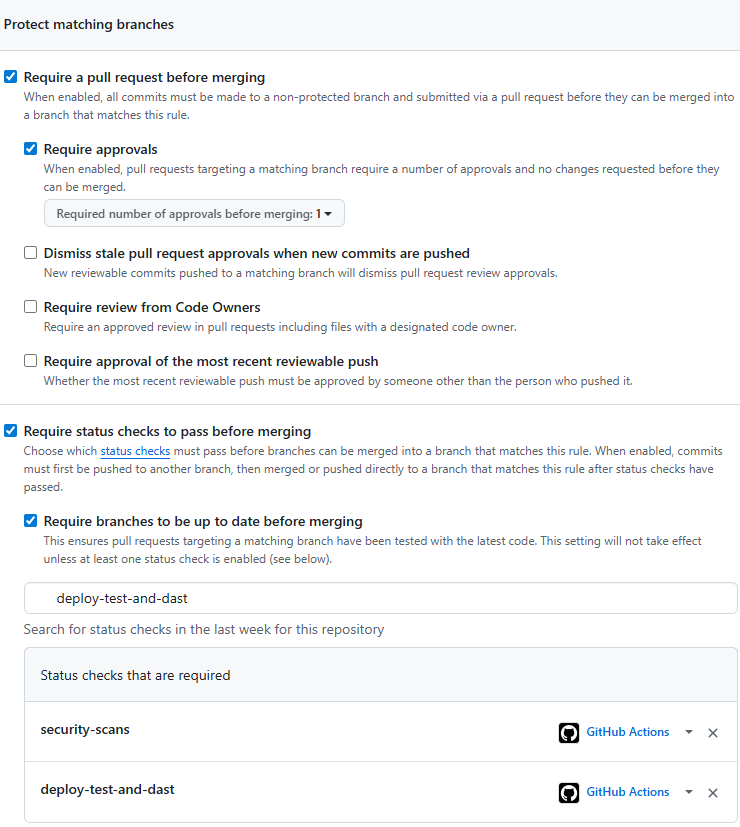
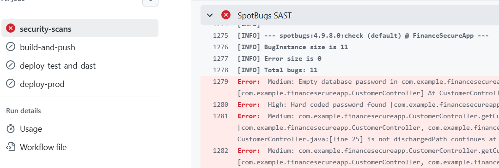
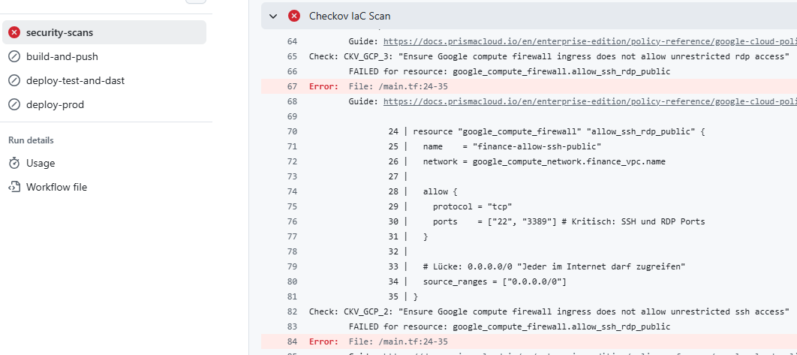

# FinanceSecureApp – DevSecOps-Pipeline mit GitHub Actions

Referenzprojekt für **Security in der CI/CD-Pipeline**. Jede Codeänderung wird automatisch auf Schwachstellen geprüft, als Container gebaut, in einer Testumgebung mit automatisierten Angriffen getestet und erst danach produktiv gesetzt. Die Beispielanwendung (Spring Boot, Java 21) ist bewusst klein, der Schwerpunkt liegt auf der Pipeline.

## Pipeline



| Stufe | Werkzeug | Zweck | Bei Fund |
|---|---|---|---|
| 1 | SpotBugs + FindSecBugs | statische Analyse des Java-Codes (u. a. SQL-Injection) | Build bricht ab |
| 1 | Semgrep | statische Analyse, hartcodierte Geheimnisse | Build bricht ab |
| 1 | Checkov | Prüfung der Terraform-Definition | Build bricht ab |
| 2 | Docker | Container-Image bauen | – |
| 3 | OWASP ZAP | Tests gegen die laufende Testumgebung | Build bricht ab |
| 4 | Cloud Run | Produktivsetzung, **nur vom `main`-Branch** | – |

**SAST** (Static Application Security Testing) untersucht den Quellcode, ohne ihn auszuführen. **DAST** (Dynamic Application Security Testing) testet die laufende Anwendung von aussen, indem typische Angriffe und Prüfungen automatisch gegen die Testumgebung ausgeführt werden.

Die Pipeline läuft bei Pushes auf `main` und `feature**` sowie bei Pull Requests auf `main`
(`.github/workflows/devsecops.yml`).

## Nachweise aus der Pipeline

**Erfolgreicher Durchlauf auf `main`** (alle vier Stufen):



**Branch Protection** auf `main` (Pull Request, Freigabe, Statuschecks `security-scans` und `deploy-test-and-dast`):



**Build-Abbruch bei Schwachstellen:** SpotBugs/FindSecBugs findet das hartcodierte Passwort und weitere Befunde,
Checkov blockiert eine Firewall-Regel, die SSH/RDP für `0.0.0.0/0` öffnet. Die nachfolgenden Stufen laufen dann nicht.





## Sicherheitskonzept

- **Vier-Augen-Prinzip:** Änderungen an `main` laufen über Pull Requests mit Pflicht-Review
  (Branch Protection).
- **Geheimnisse** (Docker-Hub-Zugang, GCP-Schlüssel) liegen ausschliesslich in GitHub Secrets,
  nie im Code.
- **Least Privilege:** Die Pipeline deployt mit einem eigenen GCP-Service-Account, der nur die
  nötigen Rechte hat.
- **Überwachung:** Alarme in GCP Monitoring/Logging bei Systemstörungen und auffälligen
  Anmeldeversuchen.

## Gefundene und behobene Schwachstellen

Die Anwendung enthielt anfangs absichtlich typische Fehler. Die Pipeline hat sie gefunden, im Code
sind die Fixes kommentiert:

| Befund | Behebung |
|---|---|
| Hartcodiertes Passwort/Secret | entfernt, Zugangsdaten aus Umgebungsvariablen |
| SQL-Injection | `PreparedStatement` mit Parametern |
| Ungeprüfter Rückgabewert | `ResultSet` wird ausgewertet |
| Log-Injection im Login-Log | Zeilenumbrüche im Benutzernamen werden ersetzt |


## Projektstruktur

```
.github/workflows/devsecops.yml   Pipeline
.zap/rules.tsv                    ZAP-Regeln (bewusst ignorierte Meldungen)
terraform/main.tf                 Cloud-Run-Definition, von Checkov geprüft
Dockerfile                        Multi-Stage-Build
src/                              Spring-Boot-Anwendung
```
Für die vollständige Pipeline sind die Repository-Secrets `DOCKER_USER`, `DOCKER_PASSWORD` und
`GCP_SERVICE_ACCOUNT` nötig.
